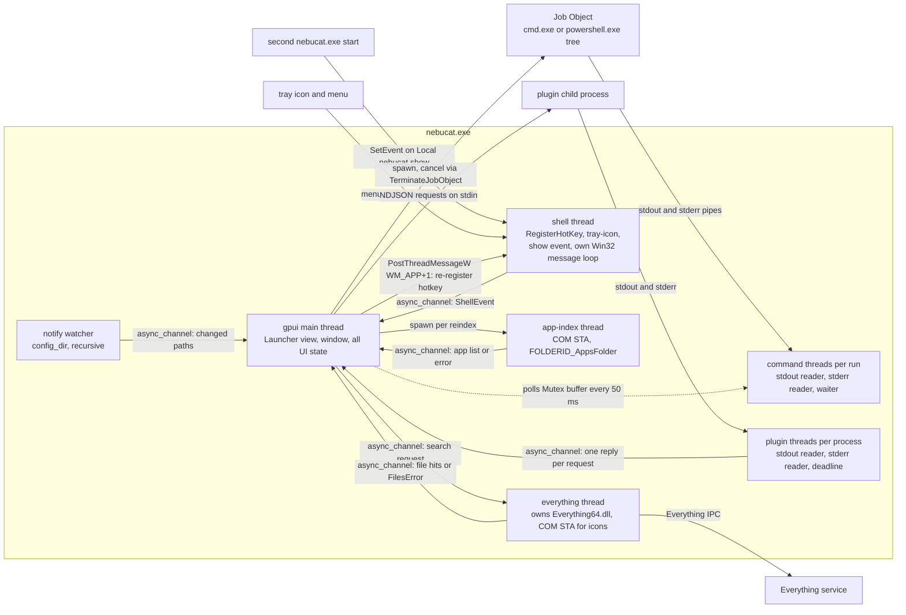

# Architecture

nebucat is one Windows process with one gpui window. The gpui main thread owns all UI state. Every slow or blocking job runs on its own thread or in a child process and reports back over a channel.

## Crates and modules

### `crates/nebucat-core`

Pure Rust library with no Windows dependencies. It builds and tests on any OS with `cargo test -p nebucat-core`.

| Module | Purpose |
|---|---|
| `query.rs` | Parses the input into `Mode`: `Apps`, `Command` (`>`), `Files` (`/`), or `Plugin` (keyword plus a space). |
| `fuzzy.rs` | Ranks names with nucleo-matcher plus history boosts; returns matched char indices. |
| `history.rs` | Launch counts and last-used times per app id; `boost(count) = 12 * ln(1 + count)`. |
| `calc.rs` | Recursive-descent f64 calculator (`+ - * / % ^`, parentheses) and result formatting. |
| `ansi.rs` | Turns command output bytes into colored spans with `vte` (SGR colors and bold). |
| `json.rs` | Pretty-prints JSON output and splits it into colored tokens. |
| `theme.rs` | `Theme` struct, the two built-in themes, and the theme file parser. |
| `config.rs` | `config.toml` schema, defaults, and the commented `DEFAULT_FILE`. |
| `hotkey.rs` | Parses strings like `Alt+Space` into modifiers and a virtual-key code. |
| `plugin_proto.rs` | Plugin manifest and wire types; see [PLUGINS.md](PLUGINS.md). |
| `url.rs` | Query-string encoding for the web fallback URL. |

### `crates/nebucat`

The Windows binary. On other targets `main` prints `nebucat runs on Windows only` and exits 1.

| Module | Purpose |
|---|---|
| `main.rs` | Single-instance mutex and show event, logging, font registration, gpui start. |
| `paths.rs` | `config_dir()` (`%APPDATA%\nebucat`), `data_dir()` (`%LOCALAPPDATA%\nebucat`), log file setup. |
| `settings.rs` | Creates the config folder layout, writes the default `config.toml`, loads it. |
| `shell.rs` | Shell thread: global hotkey, tray icon, show event, its own Win32 message loop. |
| `window_ctl.rs` | HWND lookup, DWM frame, show on the cursor's monitor, foreground focus, hide. |
| `app.rs` | `Launcher` view: query routing, rows, keyboard, output panel, window height, config watcher. |
| `apps.rs` | App index thread over `FOLDERID_AppsFolder`, app launch, `history.json` load and save. |
| `icons.rs` | Shell item icons to gpui `RenderImage` (straight-alpha BGRA). |
| `command.rs` | Runs `>` commands in a Job Object with reader and waiter threads; timeout and cancel. |
| `files.rs` | Everything thread that owns `Everything64.dll`; file hits with icons. |
| `plugins.rs` | Plugin discovery, one child process per plugin, request routing and timeouts. |
| `shellexec.rs` | `ShellExecuteW` wrapper; return codes `<= 32` become `Err(code)`. |
| `autostart.rs` | `HKCU\...\Run` value `nebucat` (release builds only). |
| `ui/theme.rs` | Picks the active theme, applies it to gpui-kit, stores it in the `ActiveTheme` global. |

## Threads and channels



### gpui main thread

Owns the `Launcher` entity, the window and every piece of UI state. Other threads never call gpui APIs. Their results arrive over `async_channel` receivers that `cx.spawn` tasks await on this thread. The same tasks implement the timers: 80 ms plugin debounce, 120 ms file debounce, 50 ms command output polling, and 200 ms config change coalescing.

### Shell thread (`shell.rs`)

A plain `std::thread` named `shell`, started before the window opens.

- Registers the global hotkey with `RegisterHotKey(None, 1, mods | MOD_NOREPEAT, vk)`. It sends `HotkeyOk`, or `HotkeyError("<hotkey> is taken by another app. Change hotkey in config.toml.")`. A modifier-only hotkey (`Win`) installs a `WH_KEYBOARD_LL` hook instead. The hook posts `WM_APP + 3` when the modifier is released with no other key pressed in between. For Win and Alt it first injects an unassigned key (`0xE8`) so Windows does not open Start or the menu bar. Injected input is ignored by the hook.
- Builds the tray icon with the menu `Show nebucat`, `Open config folder`, `Rebuild app index`, `Quit`. A left click sends `Show`.
- Loops on `MsgWaitForMultipleObjects` over the show event plus its message queue. The show event sends `Show`. `WM_HOTKEY` sends `Toggle`. Other messages go through `TranslateMessage` and `DispatchMessageW`, which tray-icon needs.

```rust
pub enum ShellEvent { Toggle, Show, ReloadIndex, OpenConfigFolder, Quit, HotkeyOk, HotkeyError(String) }
```

Events flow to gpui over an unbounded `async_channel`. The gpui side handles them in one `cx.spawn` loop that updates the `Launcher`.

The reverse direction uses thread messages. `ShellHandle::set_hotkey` stores the new hotkey in a shared `Mutex` and posts `WM_APP + 1` with `PostThreadMessageW`. The shell thread then calls `UnregisterHotKey` and registers again. Dropping `ShellHandle` posts `WM_APP + 2`, which unregisters the hotkey and ends the loop. The thread calls `PeekMessageW(PM_NOREMOVE)` before it reports its thread id, so its message queue exists before anyone posts to it.

Why the shell thread is separate from gpui's loop:

- tray-icon delivers its events through a hidden window owned by the thread that created the icon. That thread must pump messages. Keeping it on a dedicated thread means the tray never depends on gpui's message handling.
- The hotkey and the second-instance show event must work while the launcher is hidden and gpui is idle. A thread that blocks in `MsgWaitForMultipleObjects` wakes for exactly those inputs.
- `RegisterHotKey(None, ...)` posts `WM_HOTKEY` to the registering thread's queue. A thread nebucat controls is the one place that is guaranteed to see it.

### Single instance (`main.rs`)

Before gpui starts, `main` calls `CreateMutexW(None, true, "Local\nebucat.single-instance")`. If the mutex already exists, it opens the event `Local\nebucat.show`, calls `SetEvent`, and exits. Otherwise it creates that auto-reset event and passes it to the shell thread. Both handles live for the whole process.

### Window show and hide (`window_ctl.rs`, `app.rs`)

The window is a gpui `PopUp` (no taskbar button) opened hidden at startup. `show` centers it horizontally on the work area of the monitor under the cursor, places it at one quarter of the work-area height, and forces it to the foreground. If `SetForegroundWindow` alone fails, it attaches to the foreground window's input queue with `AttachThreadInput` and retries. `hide` is `ShowWindow(SW_HIDE)`. Losing activation hides the window and clears the query and output.

`SetWindowPos`, `ShowWindow` and `SetForegroundWindow` send messages such as `WM_ACTIVATE` and `WM_WINDOWPOSCHANGED` synchronously to the window procedure on the same thread. gpui's window procedure re-enters gpui and borrows its app state. If that happens inside an entity update, the state is already mutably borrowed and the `RefCell` borrow panics. So `Launcher::show` and `Launcher::hide` never call these functions directly. They spawn a detached task that runs after the current update returns. For show, that task calls `window_ctl::show`, then re-enters gpui with `update_in` to activate the window, focus the input, and log `show latency: <ms> ms` on the next frame.

### App index thread (`apps.rs`)

Spawned per index run: at startup, on `Ctrl+R` or the tray item, and on show when the index is older than 5 minutes. It initializes COM as STA, enumerates `FOLDERID_AppsFolder` through `IEnumShellItems`, reads display names, parsing names and 48 px icons, and sends one result over a `bounded(1)` `async_channel`. The 5 minute run reuses icons from the previous index by app id and extracts only new ones; `Ctrl+R` and the tray item extract all of them again. The old index keeps serving until the new one arrives. This one source covers Start menu desktop apps and Store apps. Launch is `ShellExecuteW("open" or "runas", "shell:AppsFolder\<id>")`.

gpui keeps every painted `RenderImage` in the window's sprite atlas until `drop_image`, even after the last `Arc` is dropped. When rows or the app index are replaced, `release_icons` in `app.rs` drops each outgoing icon that nothing else holds.

### Everything thread (`files.rs`)

One long-lived thread named `everything` owns `Everything64.dll`, because the Everything SDK keeps global state and is not thread-safe. It loads the DLL lazily from the exe's folder with `libloading`. Requests arrive on an unbounded `async_channel`. Before each search the thread drains the queue and keeps only the newest request; older requests get no reply. Each reply goes back on a per-request `bounded(1)` channel. The thread initializes COM as STA for file icons. Size and date modified come from Everything's index, not the file system. File icons are cached by extension for the life of the thread; folders and types with per-file icons (`exe`, `lnk`, `ico` and similar) are extracted per result.

### Command threads (`command.rs`)

Each `>` run spawns `cmd.exe` or `powershell.exe` with `CREATE_NO_WINDOW` and assigns it to a new Job Object with `JOB_OBJECT_LIMIT_KILL_ON_JOB_CLOSE`. Three threads serve one run:

- two readers append stdout and stderr bytes, in arrival order, into a `Mutex`-guarded buffer capped at 5000 lines or 2 MiB;
- a waiter polls the child every 25 ms, waits for both readers, and enforces the timeout with `TerminateJobObject`, which kills the whole process tree.

The UI does not receive pushes from these threads. It polls a snapshot of the buffer every 50 ms while the run is active. `Esc`, editing the query, or hiding the window cancels the run through the same job.

### Plugin processes (`plugins.rs`)

One child process per plugin, spawned on the first query for its keyword. Each process has three helper threads:

- a stdout reader that parses one JSON response per line and completes the matching pending request;
- a stderr reader that keeps the last 20 lines;
- a deadline thread that fails any request still pending after 2 s.

Pending requests live in a `Mutex<HashMap<id, Pending>>`. Each reply reaches the UI on a per-request `bounded(1)` `async_channel`. Deadlines travel to the deadline thread on a `std::sync::mpsc` channel. The protocol is in [PLUGINS.md](PLUGINS.md).

### Config watcher

`notify::recommended_watcher` watches `config_dir()` recursively. Its callback sends the changed paths over an unbounded `async_channel`. The gpui side waits 200 ms after the first event, drains the rest, and then reloads `config.toml`, the active theme file, or the plugin list depending on which paths changed.

## Files on disk

| Path | Content |
|---|---|
| `%APPDATA%\nebucat\config.toml` | Settings; written with defaults if missing. |
| `%APPDATA%\nebucat\themes\<name>.toml` | User themes. |
| `%APPDATA%\nebucat\plugins\<dir>\plugin.toml` | Plugin manifests. |
| `%APPDATA%\nebucat\history.json` | Launch history; written to `history.json.tmp`, then renamed. |
| `%LOCALAPPDATA%\nebucat\logs\nebucat.log` | Log at `Info` level, truncated at each start. |

## Build model

The Windows binary builds with the MSVC toolchain on a Windows host: `cargo build --release -p nebucat`, and `cargo test --workspace` for all tests. The host needs Visual Studio Build Tools with the Windows SDK.

GPUI cannot be cross-compiled from Linux or macOS. Its release build runs `fxc.exe` to compile shaders, and `fxc.exe` ships only with the Windows SDK. Debug builds load shaders from a path fixed at compile time, so run a debug binary on the machine that built it.

`nebucat-core` has no Windows dependencies, so its tests also run natively on any OS.

`Everything64.dll` is not built from this repo. `files.rs` loads it at runtime from the exe's folder, and only the `/` file search needs it. Download the Everything SDK zip from https://www.voidtools.com/Everything-SDK.zip, take `dll/Everything64.dll`, and place it beside `nebucat.exe`. nebucat never bundles the Everything app itself.
